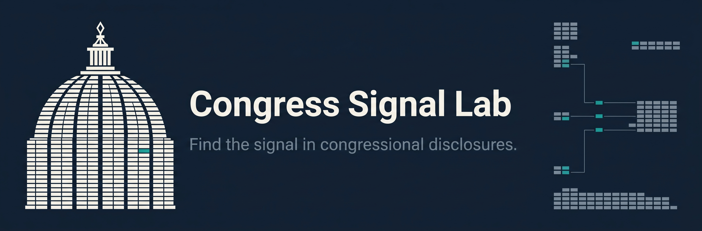
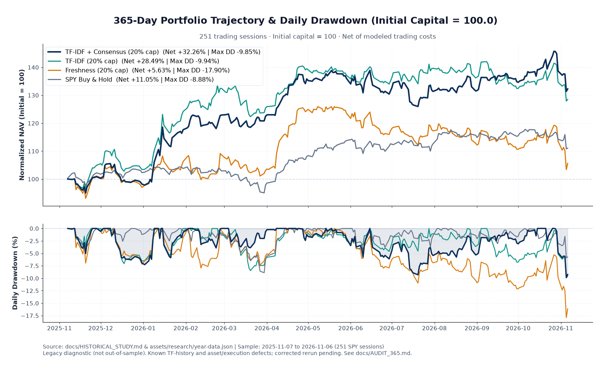
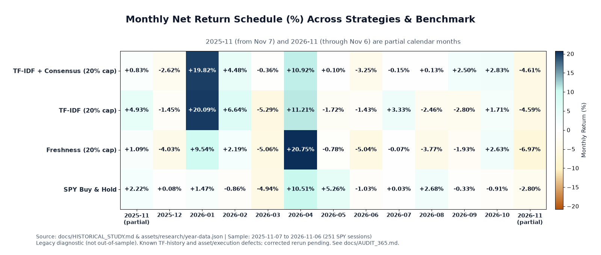
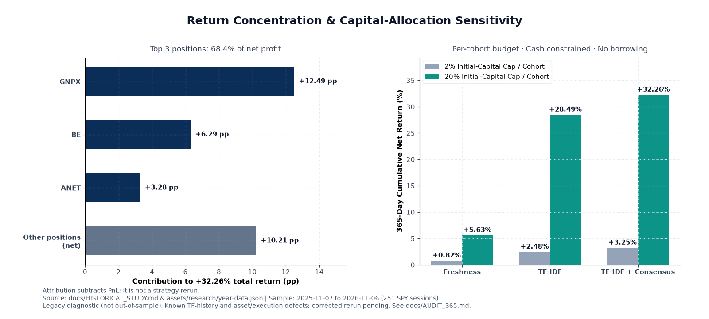

<p align="center"></p>

# Congress Signal Lab

**Find the signal in congressional disclosures.** An offline Python research toolkit for asking whether repeated buying, cross-member rarity, and disclosure timing help distinguish investment signals.

[Quickstart](#quickstart) · [Methodology](docs/METHODOLOGY.md) · [Input contract](docs/INPUT_SCHEMA.md) · [Historical study](docs/HISTORICAL_STUDY.md) · [Audit](docs/AUDIT.md)

A member's disclosed buying history is a document; a ticker is a token. TF measures repeated buying on distinct transaction dates. IDF discounts tickers bought by many members. The resulting score is an interpretable research hypothesis, not an estimate of expected returns.

## Quickstart

Python 3.11 or later. The scoring core and tests use only the standard library. An IANA timezone database with America/New_York must be available; on systems without one, install the optional tzdata package.

```bash
git clone https://github.com/jrdeng93/CongressSignalLab.git
cd CongressSignalLab
python3 -m unittest discover -s tests -v
python3 -m congress_signal_lab --input examples/synthetic.json --output output/demo.json --horizon 2
python3 scripts/audit_public_tree.py
```

The repository is currently private during release preparation; cloning requires access. The demo uses invented data. Output includes selections, exclusions, coverage, input SHA-256, and forward event returns. Output files are created exclusively: use a new filename for each run.

Optional installation in a virtual environment:

```bash
python3 -m venv .venv
. .venv/bin/activate
python3 -m pip install .
congress-signal-lab --input examples/synthetic.json --output output/installed-demo.json --horizon 2
```

## What you can run

| Component | Included behavior |
|---|---|
| Ranking | Prior-observation-day TF-IDF, filing-lag decay, basket-size adjustment, optional dated policy evidence |
| Event evaluation | Next supplied session entry, fixed holding horizon, modeled costs, matched-date SPY comparison |
| Local adapters | Austin JSON/read-only SQLite; auxiliary Kadoa provenance; dated committee snapshots |
| Audit tools | Synthetic regressions, publication hygiene checks, source and methodology notes |
| Historical figures | Redraw frozen derived NAV summaries without downloading vendor data |

The core produces **event returns**, not a cash-funded portfolio NAV. Its variants are `all`, `tfidf`, and `tfidf_policy`. The annual consensus portfolio experiment used a separate research engine. That engine and its raw datasets are not bundled; running this package does not reproduce the annual headline.

```text
Local disclosure files -> validation / quarantine -> observed-day ranking
                                                   |
Local session calendar + price bars ----------------+-> forward-event ledger
Frozen historical NAV summary ------------------------> diagnostic figures
```

## Historical experiment: a promising result with unresolved defects

> **Legacy diagnostic, needs revision.** The original annual implementation produced +32.26%. Its TF history lost distinct transaction dates, and the comparison universe contained an ETF and a zero-volume simulated trade. Corrected historical portfolio results are pending. The window overlaps historical parameter selection and is not out-of-sample. See the [full findings](docs/AUDIT_365.md).

Window: 2025-11-07 through 2026-11-06, 251 SPY sessions. Next-session open entry, 10-session holding period, 10 bps per side, up to 20% of initial capital per filing-day cohort, available-cash constrained. Committee relevance was omitted.

| Original ranking | Net return | Difference vs. SPY | Maximum daily-close drawdown |
|---|---:|---:|---:|
| Freshness | +5.63% | -5.42 pp | 17.90% |
| TF-IDF | +28.49% | +17.44 pp | 9.94% |
| TF-IDF + consensus | +32.26% | +21.21 pp | 9.85% |
| SPY buy and hold | +11.05% | — | 8.88% |



Three positions supplied 68.4% of net profit. Removing those three signals and resimulating cash, without substituting second-ranked signals, reduced the original strategy to +6.12%. Higher-cost and delayed-entry checks are described in the [study](docs/HISTORICAL_STUDY.md). A return difference is not risk-adjusted alpha.

<details>
<summary>Monthly outcomes and allocation sensitivity</summary>





</details>

## Continue the research

- [Audit entry point](docs/AUDIT.md): stable findings, reproduction commands, and evidence required to close each issue.
- [Methodology](docs/METHODOLOGY.md) and [input schema](docs/INPUT_SCHEMA.md): exact shipped-core behavior.
- [Reproducibility](docs/REPRODUCIBILITY.md): what can be rerun and what cannot.
- [Data sources and rights](docs/DATA_SOURCES.md): source versions, timing limitations, and redistribution boundaries.
- [Related work](docs/RELATED_WORK.md), [contributing](CONTRIBUTING.md), and [security](SECURITY.md).

MIT covers the code. Third-party data rights are separate. No raw vendor datasets, credentials, account integrations, or order execution are included. This is a research library; no live profitability or execution capacity has been established.
